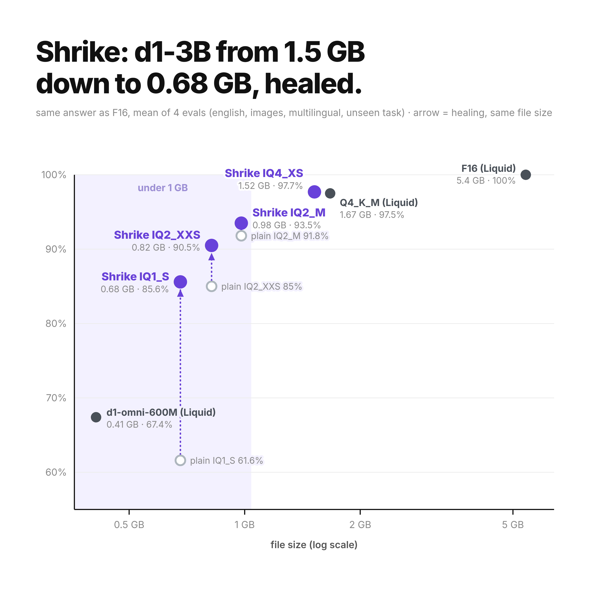
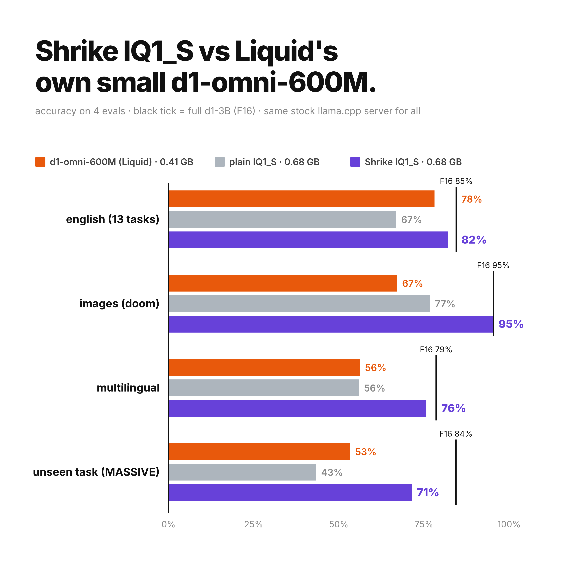

# Shrike-3B: healing low-bit d1-3B

Code behind [Shrike](https://huggingface.co/DogukanUrker/Shrike-3B): low-bit GGUF files of [LiquidAI/d1-3B](https://huggingface.co/LiquidAI/d1-3B) that
were healed with a merged LoRA. The files run on stock llama.cpp. This repo rebuilds them from scratch.

## idea

1. quantize d1-3B to 1-2 bits with `llama-quantize`.
2. student = d1-3B text model whose linear weights are the **dequantized low-bit weights** (exactly what llama.cpp
   computes), plus a LoRA on every linear layer.
3. teacher = full d1-3B. loss = KL to the teacher's top-32 distribution at the answer position (yes/no, option letters,
   score digits). no labels needed.
4. data: ~15k text prompts (english + 15 languages, yes/no, choice, score) and ~4k image prompts (coco, doom, mario)
   fed as llama.cpp's own input embeddings.
5. `llama-export-lora` merges into F16, `llama-quantize` makes one normal gguf again.
6. soup (used for the released IQ2_M, IQ2_XXS and IQ1_S): heal twice with different data mixes, then average the adapters:
   `llama-export-lora -m d1-3B-F16.gguf --lora-scaled run_a/adapter.gguf:0.5,run_b/adapter.gguf:0.5 -o soup-F16.gguf`
   and `llama-quantize --imatrix ... soup-F16.gguf soup.gguf IQ1_S`.
7. 4 bits: the 1-2 bit learning rate (2e-4) made IQ4_XS worse. the released IQ4_XS is one gentle heal:
   `LR=2e-5 python3 heal/heal.py d1-3B-IQ4_XS.gguf runs/IQ4_XS 1000`. it ties a plain IQ4_XS, both beat Liquid's Q4_K_M.

## run it

```
git clone https://github.com/ggml-org/llama.cpp && cd llama.cpp
cmake -B build -DBUILD_SHARED_LIBS=OFF -DGGML_CUDA=ON && cmake --build build -j --target llama-server llama-quantize llama-imatrix llama-export-lora mtmd
cd .. && CUDA=1 ./reproduce.sh IQ1_S 3000
```

a 12 GB gpu is enough. healing IQ1_S takes ~2 h on an rtx 3060, the evals ~10 min per file.

## layout

| path | what |
|---|---|
| `common.py` | paths, all overridable: `LLAMA_CPP`, `D1_HF`, `D1_GGUF`, `DM_DATA`, `DM_WORK` |
| `data/fetch_data.py` | every public dataset slice used (fixed seeds) |
| `frames/doom_collect.py`, `frames/mario_collect.py` | game frames with engine ground truth |
| `heal/build_prompts.py`, `heal/build_images.py` | healing prompts |
| `heal/heal.py` | the distillation (env: `PROMPTS`, `IMG_EMBD`, `RANK`, `LR`) |
| `heal/merge.sh` | adapter -> one stock gguf |
| `eval/tasks.py` | every eval task, rendered exactly like llama-server |
| `eval/run_all.sh`, `eval/run_evals.py`, `eval/score.py` | evaluate any gguf on a stock llama-server |
| `tools/d1x.cpp` | small llama.cpp runner: image embedding dumps, early exit experiments |
| `tools/cut_gguf.py`, `tools/prune_gguf.py` | experiments that did not make the release (see the blog post) |

## results

`results/final_scoreboard.md` and `results/results.json`: every file scored with `eval/` on a stock llama-server.





## evals

english (13 tasks x 100), doom frames (240, engine labels), multilingual (xnli, paws-x, sentiment, ~1300 decisions),
MASSIVE (332 requests, 9 languages, never used in healing). agreement = same top answer as F16.

## license

code: MIT (see LICENSE). the weights it produces are derivatives of LiquidAI/d1-3B under the LFM Open License v1.0,
and so are the released files at https://huggingface.co/DogukanUrker/Shrike-3B.
